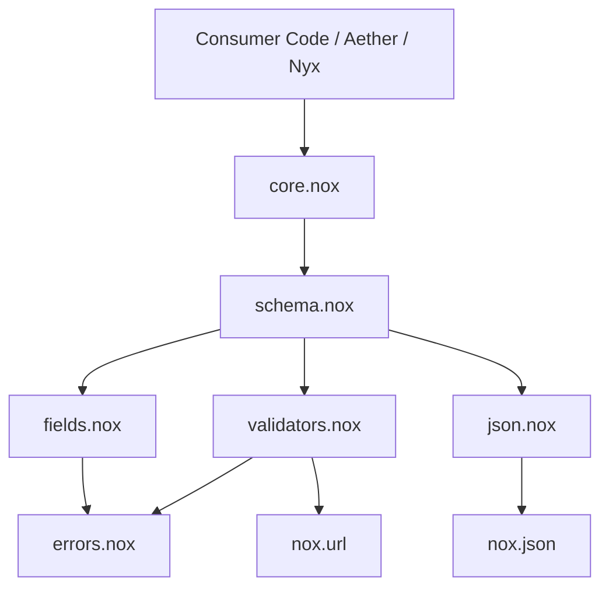

# Noxen Architecture Specification

## 1. Overview and Design Principles

Noxen is a static data modeling, parsing, validation, and serialization library for Nox.
It adheres strictly to the following principles:

1. **Nox-first & Idiomatic**: Uses real, verified Nox 2.0 language features without runtime shims or unverified constructs.
2. **Static Typing Always**: Preserves Nox's compile-time static type system. No dynamic casts or fake `Any`.
3. **Capability-gated**: Decouples validation, typed mapping, serialization, and JSON schema generation.
4. **Deterministic & Strict by Default**: Predictable error ordering, unknown fields forbidden by default, no implicit type coercion.

## 2. Logical Components and Module Map

```text
noxen/
  ├── core.nox             # Core orchestration: ModelSchema[T], ValidatedData, Result[T]
  ├── errors.nox           # FieldError, ValidationError, stable error codes
  ├── fields.nox           # Field definition, presence rules, default values
  ├── schema.nox           # Schema container, unknown-field policies, JSON Schema generation
  ├── validators.nox       # Primitive type checkers, bounds, formats (email, url, uuid), custom hooks
  ├── json.nox             # Adapters for nox.json and safe parsing
  ├── noxen/               # Namespaced re-exports for consumer consistency
  │     ├── core.nox
  │     ├── errors.nox
  │     ├── fields.nox
  │     ├── schema.nox
  │     └── validators.nox
  ├── tests/               # Unit, integration, and regression suites
  └── docs/                # Architectural, compatibility, and validation specifications
```

### Dependency Hierarchy



Dependency flow is strictly unidirectional with no circular dependencies.

## 3. Core Component Contracts

### 3.1 Errors (`errors.nox`)
- `FieldError`:
  - `path: str`: Full dot-and-index path (e.g. `user.profile.website`, `items[0].id`).
  - `code: str`: Stable machine code (`missing_field`, `type_mismatch`, `unexpected_null`, `extra_field`, `out_of_range`, `string_too_short`, `string_too_long`, `invalid_email`, `invalid_url`, `invalid_uuid`, `custom_validation_error`).
  - `message: str`: Human-readable explanation.
  - `expected: str`: Expected type or constraint description.
  - `actual: str`: Actual type or category observed.
- `ValidationError`:
  - Inherits from `Exception`.
  - Exposes `errors: list[FieldError]`.
  - Exposes `to_json() -> str` formatting a structured error array.

### 3.2 Fields (`fields.nox`)
- `Field`:
  - Defines field name, target kind (`"string"`, `"int"`, `"float"`, `"bool"`, `"list"`, `"object"`).
  - Presence mode:
    - `REQUIRED`: Must exist in JSON, cannot be null.
    - `REQUIRED_NULLABLE`: Must exist in JSON, can be null.
    - `OPTIONAL`: May be missing; if present, cannot be null.
    - `OPTIONAL_NULLABLE`: May be missing; if present, can be null.
  - Default value support:
    - Separate typed defaults (`default_str`, `default_int`, `default_float`, `default_bool`).
  - Constraints:
    - Numeric: `min_val`, `max_val`, flags `has_min`, `has_max`.
    - String: `min_len`, `max_len`, `pattern`, `format` (`"email"`, `"url"`, `"uuid"`).
    - Nested: `nested_schema` for objects, `item_kind` / `item_schema` for lists.

### 3.3 Schema (`schema.nox`)
- Container for field definitions.
- Unknown fields policy:
  - `Policy.FORBID` (value 0, default): Reports extra fields as errors.
  - `Policy.IGNORE` (value 1): Ignores unexpected fields.
- JSON Schema Generator:
  - Generates standard JSON Schema Draft 2020-12 representation for properties, types, required arrays, constraints, and descriptions.

### 3.4 Validated Data Container (`core.nox: ValidatedData`)
- High-efficiency parsed result keeping typed values without dynamic dispatch.
- Type-safe accessors:
  - `get_str(name: str) -> str`
  - `get_int(name: str) -> int`
  - `get_float(name: str) -> float`
  - `get_bool(name: str) -> bool`
  - `get_opt_str(name: str) -> str | None`
  - `get_opt_int(name: str) -> int | None`
  - `get_opt_float(name: str) -> float | None`
  - `get_opt_bool(name: str) -> bool | None`
  - `get_list_str(name: str) -> list[str]`
  - `get_list_int(name: str) -> list[int]`
  - `get_list_float(name: str) -> list[float]`
  - `get_list_bool(name: str) -> list[bool]`
  - `get_object(name: str) -> ValidatedData`
  - `get_opt_object(name: str) -> ValidatedData | None`
  - `get_list_object(name: str) -> list[ValidatedData]`

### 3.5 Model Schema and Result (`core.nox: ModelSchema[T], Result[T]`)
- Generic wrapper `ModelSchema[T]` parameterised by concrete model type `T`.
- Takes a factory `(ValidatedData) -> T`.
- `parse_json(json_str: str) -> Result[T]`:
  - Parses JSON using `nox.json.parse`.
  - Runs schema validation.
  - Returns `Result[T]` containing either the typed model instance or the ordered list of `FieldError`s.
- `Result[T].unwrap() -> T`:
  - Returns the model if valid; raises `ValidationError` if validation failed.
